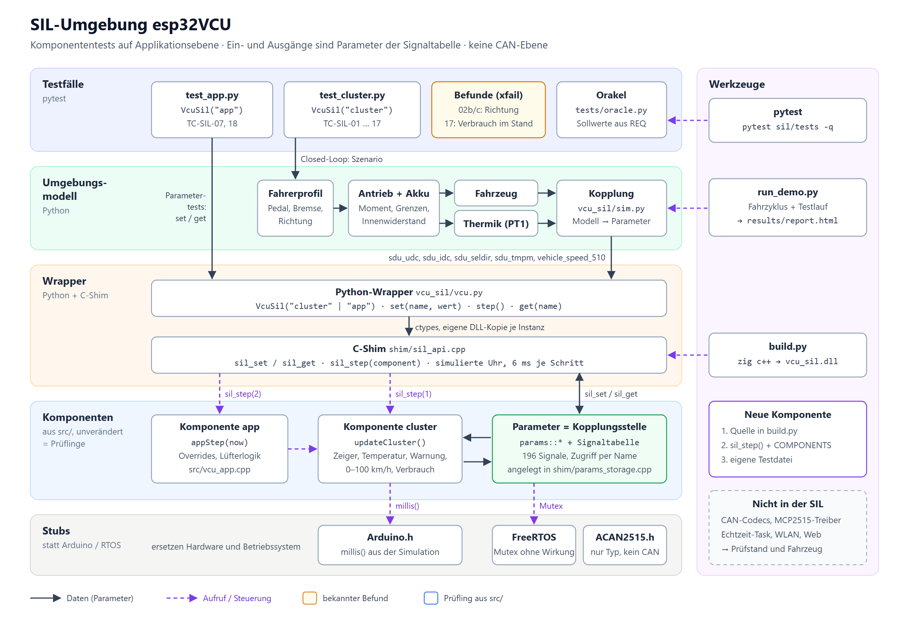

# Software-in-the-Loop (`sil/`)

Komponententests auf **Applikationsebene**: einzelne, unveränderte Komponenten aus `src/` laufen auf dem PC. Ein- und Ausgänge sind die Parameter der Signaltabelle, gesetzt und gelesen über ihren Namen. Es gibt **keine CAN-Ebene**: Codecs und Treiber werden nicht gebaut. Für geschlossene Szenarien liefert ein Python-Modell der Umgebung die Eingangsparameter. Demo-Prüfling ist die Kombi-Funktion. Architektur: [architecture.html](architecture.html) (interaktiv), Bild: [architecture.png](architecture.png) / [architecture.svg](architecture.svg).



| Komponente | Aufruf je Schritt | Quelle |
|---|---|---|
| `VcuSil("cluster")` | `updateCluster()` | `src/app/cluster_calc.cpp` |
| `VcuSil("app")` | `appStep(now)`: Kombi, ECU-Overrides, Lüfterlogik | `src/app/vcu_app.cpp` |

```text
pytest / run_demo.py
   │  Szenario, Sollwerte (tests/oracle.py)
   ▼
Umgebungsmodell (vcu_sil/model.py)   Fahrer → Antrieb + Akku → Fahrzeug, Thermik
   │  sdu_udc, sdu_idc, sdu_seldir, sdu_tmpm, sdu_tmphs, vehicle_speed_510 …
   ▼
Kopplung (vcu_sil/sim.py) ─ set(name) / step() / get(name)
   ▼
Wrapper: VcuSil("cluster" | "app") (ctypes, vcu_sil/vcu.py) → C-Shim (shim/sil_api.cpp)
   ▼
Komponente: updateCluster() bzw. appStep()  ·  Daten: params + Signaltabelle
   +  Stubs (Arduino-Zeit, FreeRTOS-Mutex, CANMessage-Typ nur für die Header)
```

## Benutzen

```bash
python -m pip install --user ziglang   # einmalig: C++-Compiler (Clang) als Python-Paket
python -m pytest sil/tests -q          # baut die DLL bei Bedarf selbst, ca. 5 s
python sil/run_demo.py                 # Fahrzyklus + Testlauf -> sil/results/report.html
python sil/make_architecture.py        # architecture.json -> architecture.html
```

Python-Beispiel:

```python
from vcu_sil import VcuSil
vcu = VcuSil("cluster")              # eigene Instanz der Komponente
vcu.set_many({"sdu_udc": 348, "sdu_idc": 150, "sdu_seldir": -1})
vcu.step()                           # ein 6-ms-Zyklus: updateCluster()
vcu.get("cluster_needle_position")   # 6055
```

## Prinzip

- **Gleicher Code:** `build.py` kompiliert die Komponenten direkt aus `src/` (`cluster_calc`, `vcu_app`, `vcu_params`, `signal_table`). Die Signalgruppen, die in der Firmware in den Codec-Modulen angelegt sind, legt `shim/params_storage.cpp` an. Die Uhr (`millis()`) gibt die Simulation vor.
- **Kopplung über Parameter:** Jeder Wert der Signaltabelle (196 Signale) lässt sich über seinen Namen setzen und lesen, mit dem C++-Speichertyp des Feldes.
- **Takt:** `step()` rückt die Uhr um 6 ms vor und ruft die gewählte Komponente einmal auf. Das Modell rechnet je Zyklus 6 Unterschritte.
- **Unabhängige Sollwerte:** `tests/oracle.py` rechnet aus der Anforderung VCU-REQ-005 nach, nicht aus dem C-Code.
- **Frischer Zustand:** Jede `VcuSil`-Instanz lädt eine eigene Kopie der DLL, damit statische Zustände der Firmware (Beschleunigungsmessung, Verbrauchszähler) je Test neu beginnen.

## Testfälle

| ID | Inhalt | Anforderung |
|---|---|---|
| TC-SIL-01 | Neutral → feste Zeigerstellung 822 | VCU-REQ-005 |
| TC-SIL-02a | Richtungslogik festgehalten (Charakterisierung) | VCU-REQ-005 |
| TC-SIL-02b/c | **Befund (xfail):** OpenInverter „Forward“ (+1) wird als Rückwärts gewertet, „Reverse“ (−1) zeigt Leistung | VCU-REQ-005 |
| TC-SIL-03 | Leistungsskala: Totband ±5 %, Antrieb 4100–7950 (+30), Rekuperation bis 1600, Begrenzung; 17 Punkte | VCU-REQ-005 |
| TC-SIL-04 | Zeiger steigt monoton mit der Leistung | VCU-REQ-005 |
| TC-SIL-05 | Kühlmittelanzeige = Motortemperatur, begrenzt auf −48…143,25 °C | VCU-REQ-005 |
| TC-SIL-06 | Kühlmittelwarnung ab Kühlkörper 80 °C oder Motor 160 °C (Grenzfälle) | VCU-REQ-005 |
| TC-SIL-07 | `app`: Override vor Rechnung, Freigabe stellt die Rechnung wieder her | VCU-DEC-005 |
| TC-SIL-08 | Anpassung aus: ECU-Werte bleiben, kein Verbrauch | VCU-REQ-005 |
| TC-SIL-11 | 0–50 und 0–100 km/h ± 0,1 s gegen die exakte Modellzeit | VCU-REQ-007 |
| TC-SIL-12 | Zwei Läufe: letzter und bester Wert | VCU-REQ-007 |
| TC-SIL-13 | Fliegender Start wird nicht gewertet | VCU-REQ-007 |
| TC-SIL-14 | Fahrzyklus: Zeiger folgt in jedem Zyklus dem Orakel | VCU-REQ-005 |
| TC-SIL-15 | Überhitzung (schlechte Kühlung) setzt die Warnung im selben Zyklus | VCU-REQ-005 |
| TC-SIL-16 | MO5-Zähler: 15-bit-Überlauf mit Überlauf-Bit | VCU-REQ-006 |
| TC-SIL-17 | **Befund (xfail):** Verbrauch steigt im Stand (noch Simulation) | VCU-REQ-006 |
| TC-SIL-18 | `app`: Override wirkt auch bei abgeschalteter Kombi-Anpassung | VCU-DEC-005 |

TC-SIL-09/10 (CAN-Frames) sind entfallen; Komponententests bleiben auf Applikationsebene. Tests: `tests/test_cluster.py` (Komponente `cluster`), `tests/test_app.py` (Komponente `app`).

`xfail(strict=True)` heißt: Der Test beschreibt das geforderte Verhalten und schlägt heute erwartungsgemäß fehl. Ist der Befund behoben, wird der Test rot, und die Markierung muss entfernt werden.

## Grenzen

- Das Modell ist grob (geschätzte Parameter, keine Reifenhaftung, keine Steigung). Es dient als plausible Umgebung, nicht als Abbild des Fahrzeugs.
- Nicht abgedeckt: CAN-Kodierung, Zeitverhalten auf dem ESP32, Interrupts, Treiber, WLAN. Dafür bleiben Prüfstand und Fahrzeug (TESTPLAN.md).
- Neue Komponente aufnehmen: Quelle in `build.py` ergänzen, in `sil_step()` (`shim/sil_api.cpp`) und `COMPONENTS` (`vcu_sil/vcu.py`) eintragen, eigene Testdatei mit Fixture `VcuSil("<name>")`.
- Compiler ist Clang über Zig (`x86_64-windows-gnu`); der ESP32 nutzt GCC für Xtensa. Unterschiede bei Gleitkomma-Rundung sind möglich; die Toleranzen der Tests berücksichtigen das.
